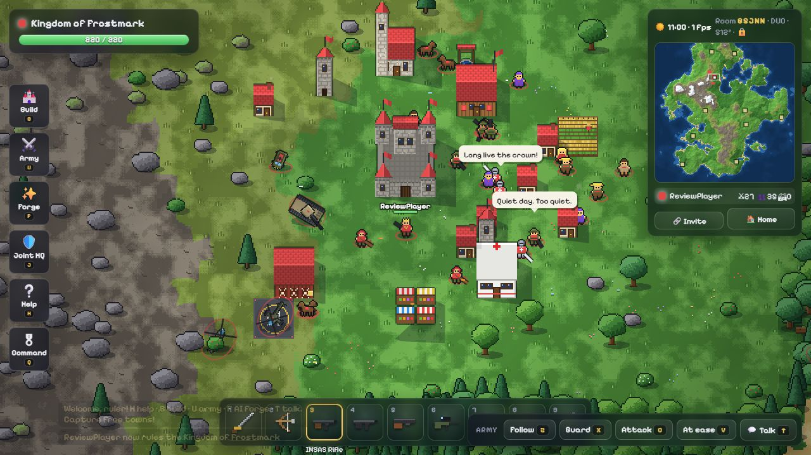

# Pixel Kingdoms project analysis

Reviewed on 14 October 2026. Scope: the existing project in `C:/Users/razer/Desktop/warrrr`, the supplied Claude conversation, the downloaded Freeciv archive, and the upstream repository documentation. Game source and existing saves were not changed. Runtime tests used separate ports and temporary save directories, with external AI calls disabled.

This is a playable multiplayer kingdom sandbox with substantial implemented content. It does not yet deliver unrestricted life simulation, arbitrary AI-created mechanics, or reliable public hosting. Continue improving this implementation; replacing it again would discard working multiplayer, rendering, and simulation code.

## What was actually built

The local project is an independent Node.js implementation called Pixel Kingdoms. It serves browser assets and WebSockets from one process. There is no Freeciv C simulation, Java/Tomcat application, or Python proxy in this folder. Its README describes inspiration from Freeciv and attributes the copied music to that repository.

The earlier statement that Freeciv "can't become" a real-time game is too absolute. Its existing architecture and turn-based rules make this a major redesign. Building a separate simulation was a practical architectural choice, rather than evidence that modification is impossible. [Freeciv's own architecture description](https://github.com/freeciv/freeciv-web#overview) explains the original components.

| Component | Implementation |
|---|---|
| Server and lobby | `server/index.js`: static HTTP, WebSocket connections, public/private rooms, joining, reconnects, saves |
| Simulation | `server/game.js`: 30 Hz authoritative simulation, movement, combat, towns, wildlife, vehicles, crews |
| Strategic AI | `server/command.js`: alliances, operations, target assessment, computer kingdom decisions |
| Language model integration | `server/ai.js`: Claude, Ollama, Pollinations, then procedural/rule fallbacks |
| Persistence | `server/store.js`: compressed JSON saves and metadata, temporary-file replacement |
| Browser | `public/client.js` and `public/gfx.js`: Canvas rendering, HUD, input, effects, interpolation |
| Shared content | `public/shared`: procedural/geographic maps, units, buildings, weapons, sprites |
| Background rendering | `public/chunkworker.js`: terrain chunks and object overlays |

## How it matches your requested game

| Requested behavior | Current state |
|---|---|
| Each player receives a kingdom | Implemented; separate kingdoms confirmed in multiplayer tests |
| Duo / Squad / Penta rooms | Implemented and tested with 2 / 4 / 5 simulated clients |
| Friends join using a room code | Implemented; full rooms reject extra clients; token reconnects worked |
| Large, unlocked world | Finite maps from 512 × 512 to 2048 × 2048 tiles; random, India, and Earth options; no progression gate on map access |
| No levels | No player leveling or technology progression gate in the inspected gameplay |
| No limits | Inaccurate: at most 10 kingdoms, 90 combat units and 60 civilians per kingdom, finite terrain, bounded generated stats and action cooldowns |
| Loyal, intelligent NPCs | Own units accept commands and use programmed combat/crew behavior; language models supply dialogue and periodic plans. Orders are parsed with keyword rules |
| Create custom NPCs, weapons, vehicles, buildings | Implemented as bounded definitions and 16 × 16 sprites; offline forging worked |
| AI can create anything | Not implemented. A prompt can configure supported attributes, but cannot introduce an arbitrary new mechanic |
| Jets, tanks, ships | Many built-in types exist. Custom vehicles have much less expressive definitions |
| Do anything like real life | This is primarily a combat/building sandbox. It lacks a general economy, crafting supply chains, civilian jobs, a persistent NPC life planner, and arbitrary world interactions |
| Properly working internet play | A server and deployment documentation exist; public internet play, latency tolerance, and sustained capacity remain unverified |

## Findings to fix

### 1. P1 — A valid JSON value can terminate the entire server

Location: `server/index.js:114` and `server/index.js:126`.

Reproduced: connect to the lobby WebSocket and send the JSON text `null`. Parsing succeeds, but `msg.t` throws outside the in-room catch. The process exits with code 1. Every room on that server loses its connection; the crash bypasses the normal SIGINT/SIGTERM save path.

Validate that messages are non-null objects with an allowed message type before dispatch. Catch failures around the entire asynchronous message handler, including lobby operations. Add socket error handling and per-connection message budgets.

### 2. P1 — A malformed URL can terminate the entire server

Location: `server/index.js:19`.

Reproduced: requesting `/%E0%A4%A` causes an uncaught `URIError` from `decodeURIComponent`. The process exits with code 1.

Catch decoding errors and return HTTP 400. Also replace the string-prefix static-file containment check with a path-relative boundary check.

### 3. P1 — Failed idle-room saves remove the recoverable in-memory world

Location: `server/index.js:179`–`server/index.js:184`.

Code-reviewed failure path: the idle cleanup removes the room from `rooms` and destroys its timer before awaiting persistence. If writing fails, the room is not added to `sleeping`; its latest state is no longer retained by the server. An older disk save may remain, but the current world can be lost until restart/recovery.

Persist successfully before unloading. Keep failed saves in memory, report failure, and retry. Serialize saves per room to avoid overlapping writes.

### 4. P2 — NPC command parsing reverses negative instructions

Location: `server/ai.js:665` onward; applied before dialogue in `server/game.js:3285`.

Reproduced directly against the parser:

| Text | Parsed command |
|---|---|
| `everyone follow me` | follow, everyone |
| `do not attack anyone` | **attack** |
| `do not follow me` | **follow** |
| `build a hospital` | none |
| `find food and trade with the next town` | none |

This matters because actions execute before the language model writes its reply. Better dialogue cannot repair the action already chosen. Add explicit negation, unsupported-intent handling, and a cease-fire action. Expand NPC work through validated actions and world-state checks.

### 5. P2 — The custom vehicle schema cannot express the requested jet behavior

Locations: `server/ai.js:320`, `server/ai.js:425`, `server/game.js:693`, `server/game.js:821`.

Reproduced with the offline description `A fighter jet with missiles`: it produces an air vehicle, but its physics are `heli: true`, its secondary weapon is null, and missile ammunition is zero. The code assigns helicopter handling to every custom air vehicle, including successful model-generated ones. The schema has no vehicle class, secondary weapon, or missile configuration.

Add explicit vehicle classes and supported equipment slots. Validate each capability against simulation code. Give the Forge a truthful description of which features were created or substituted.

### 6. P2 — Server terrain edits are not synchronized to browsers

Locations: `server/game.js:895`, `public/client.js:399`, `public/client.js:679`.

Forced building placement can reclaim water as sand. The browser and its workers regenerate the original terrain from the seed; the join message contains no terrain edits. Saves preserve the modified server terrain, but clients still reconstruct the original map.

In the sampled newly created worlds, server terrain differed from seed regeneration at 2 tiles on India and 4 on Earth. This can display water where server collision permits land movement/buildings. Transmit sparse terrain changes on join and update, and apply them to rendering workers too.

### 7. P2 — Free online AI scheduling does not match the provider's documented limit

Locations: `server/ai.js:116` and `server/ai.js:151`.

The queue waits 3 seconds between request starts, and rate-limit retries wait 12 seconds. Pollinations currently documents one anonymous text request at a time, at least **30 seconds apart**, with best-effort availability. Every room shares this server IP and global queue, so background dialogue can delay player requests. [Official Pollinations Classic documentation](https://github.com/pollinations/pollinations/blob/master/APIDOCS.md#limits).

Implement provider-specific scheduling, honor rate-limit headers, prioritize player actions, and set an overall deadline for each job. `aiStatus()` currently indicates a configured/eligible provider rather than a successful live health check. Do not promise a guaranteed free online AI service or fixed response time.

## Verification performed

| Check | Result |
|---|---|
| JavaScript parsing | All 11 JavaScript files passed `node --check` |
| Production dependencies | `npm audit --omit=dev --json` reported zero known vulnerabilities; system CA support was required for this environment |
| HTTP | Lobby, client JS, India geography JSON, gallery, and health endpoint returned 200 |
| Duo / Squad / Penta | Correct capacities and distinct kingdoms; extra players rejected |
| Simulation snapshots and input | Received snapshots; movement changed the controlled player's position in all three formats |
| Reconnect | Rejoined the same kingdom using its token in all three formats |
| Offline Forge | Created an air vehicle and a 16-row pixel sprite in all three formats |
| Save/load | Mega-world units, buildings, towns, custom catalog, and kingdom reconnect survived a direct persistence round trip |
| Map initialization | Random Mega, India Large, and Earth Large initialized and stepped |
| Browser | Created a private Duo game through the actual lobby; rendered gameplay; no captured browser warnings/errors during that check |
| Malformed input | Both crash findings above reproduced in isolated server processes |

The simulation sample also showed that server cost needs realistic measurement. Across 30 manually invoked ticks, the random Mega world had 3,808 units and 11,795 buildings, with a median tick of about 12.7 ms and sampled 95th percentile of 49.5 ms. India Large sampled about 18.1 ms median. These are short, synchronous diagnostic samples, not a sustained gameplay benchmark. They do not establish how many rooms a VPS can support. A 30 Hz loop has roughly 33.3 ms per tick, shared with other work on Node's event loop.

No paid AI requests were made. Claude generation, an actual Ollama model, live Pollinations responses, long-running combat, aircraft landing, alliance edge cases, mobile input, internet latency, and multi-room load were not validated. The current Claude model ID and fallback beta string are present in the installed SDK; there is no basis to call them invented, but a live provider request remains untested.

## Suggested development order

1. Fix malformed-input crashes and persistence failure handling; add regression checks for these exact failures.
2. Synchronize terrain edits, fix NPC negation, and distinguish generated dialogue from supported actions.
3. Introduce an explicit Forge capability schema: vehicle class, primary/secondary weapons, crew, cargo, sensors, and production rules, implemented one capability at a time.
4. Establish a dependable AI provider configuration with measured response times and clear offline status.
5. Load-test real game sessions before changing capacity limits. Move expensive room generation off the shared event loop and bound rooms, queues, and outgoing socket buffers as needed.
6. Build the life-simulation layer you want: resources, jobs, inventory, crafting, trade, schedules, NPC memory, and a validated planner. Make these systems interact before expanding the content list further.
7. Package the project for distribution: initialize version control, add a Node engine requirement and repeatable checks, include the declared license text, and record source/permission information for each reused music asset. The archive's music folder did not expose an obvious music-specific README/license/credits file in the inspected entry names; provenance needs an explicit record.

A tunnel can make the server reachable, but it does not resolve the reproducible crashes or prove multiplayer reliability. The next useful milestone is a stable five-player session with correct commands, reliable saves, and measured performance.
